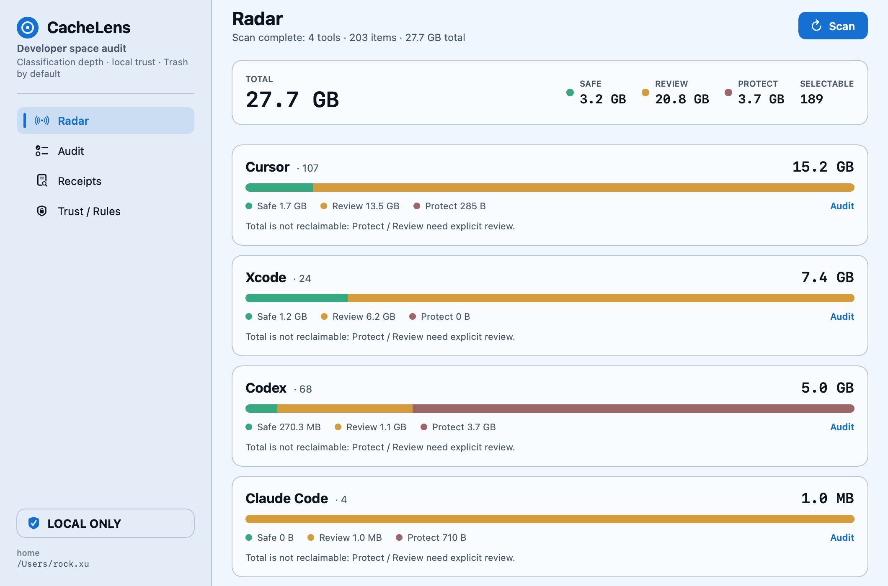
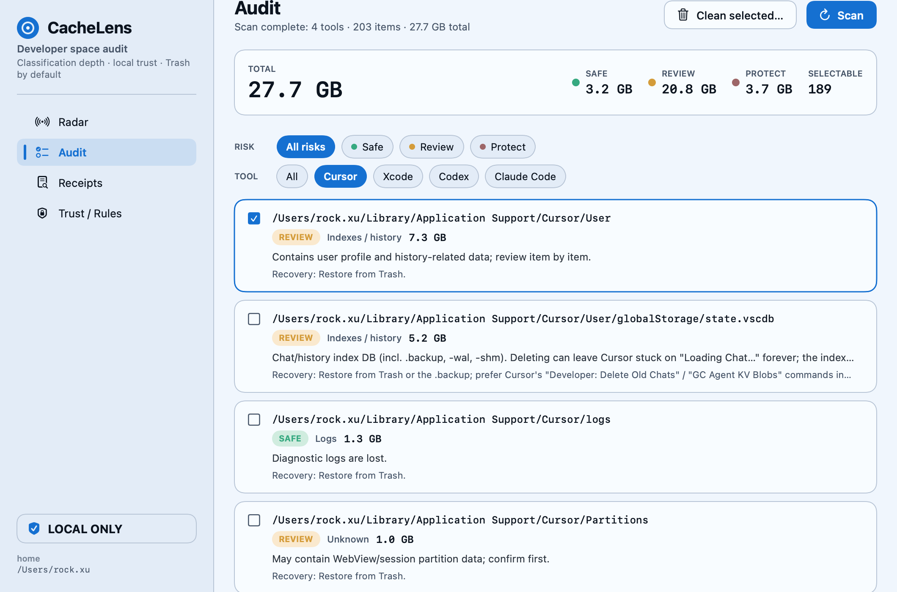

<div align="center">



# CacheLens

**Explainable AI Dev Cache & State Inspector for macOS (SwiftUI App + CLI)**

[](LICENSE)
[](#requirements)
[](#build-from-source)
[](#zero-network-verification)

[**Website**](https://getcachelens.pages.dev/) · [**Download DMG**](https://getcachelens.pages.dev/download) · [**简体中文**](README.zh-CN.md) · [**Safety Boundaries**](docs/trust/safety-boundaries.md)

</div>

---

## Why CacheLens?

Generic Mac cleaners treat AI developer directories as disposable junk. In modern AI coding workflows, blindly deleting folders causes catastrophic context loss:

- **Cursor `state.vscdb*`**: Deleting this index/history DB can leave Cursor permanently stuck on `"Loading Chat..."`. CacheLens classifies it as **Review** (never Safe) and points you to Cursor's built-in cleanup commands.
- **Cursor `snapshots/*.pack`**: Checkpoint packs can balloon to **50–150 GB** in days and refill immediately if deleted while Cursor is running. CacheLens flags `May recreate`, explains that code/settings remain intact, and blocks cleanup while Cursor is open.
- **Claude Code & Codex**: Prompt transcripts, project trees, and `.credentials.json` / `auth.json` are separated—credentials and sessions stay locked under **Protect**.
- **Ollama / LM Studio / Hugging Face**: Multi-gigabyte `.gguf` weights are marked **Review**, never silently wiped.

### How CacheLens Complements `Mole` (`tw93/Mole`)

[`tw93/Mole`](https://github.com/tw93/Mole) is fantastic for general macOS system cleanup, app uninstalls, and broad caches. **CacheLens** is the surgical companion specifically for **AI IDEs and coding agents**: instead of maximizing reclaimed gigabytes, CacheLens focuses on **classification depth, deletion consequence explanations, fail-closed rule integrity, and Trash-only recovery**.

---

## Key Features

- **3-Tier Risk Model (`Safe` / `Review` / `Protect`)**:
  - **Safe**: Regenerable cache with verified layout markers and a known recovery path.
  - **Review**: Large or costly state (chat DBs, snapshots, model weights) requiring explicit confirmation.
  - **Protect**: Auth tokens, credentials, and settings—hard-locked and unselectable.
- **Fail-Closed Stale-Rule Downgrade**: Every `Safe` rule carries `verifiedAgainst` metadata (`verifiedAt` + `layoutMarkers`). If an AI IDE updates and changes its directory layout, CacheLens automatically downgrades the rule to **Review** instead of guessing.
- **Trash by Default + Local Receipts**: Strictly uses `FileManager.trashItem` (never `rm -rf`). Every cleanup appends a structured JSONL receipt to `~/Library/Application Support/CacheLens/receipts/`.
- **Process Guard & TOCTOU Preflight**: Refuses cleanup if the owning tool is running, if process state is unknown, or if disk state drifted between scan and clean.
- **Bundled `cachelens` CLI**: Interactive ANSI-colored space radar when invoked with zero arguments, plus `--json` and `--dry-run` for scripting.
- **100% Local & Zero Network**: No `URLSession`, no analytics SDKs, no path telemetry.

<p align="center">
  
</p>

---

## Supported Tools (16)

| Category | Tools |
| :--- | :--- |
| **AI IDEs & Editors** | Cursor, Windsurf, Trae, Antigravity, Zed |
| **Terminal & Coding Agents** | Claude Code, OpenAI Codex, OpenCode, Aider |
| **IDE Extensions** | Cline, Roo Code, Continue |
| **Local Models & Apple Dev** | Ollama, LM Studio, Hugging Face, Xcode (`DerivedData`, `Archives`, `DeviceSupport`, `CoreSimulator`) |

---

## Installation

### Homebrew Cask (Recommended)

```bash
brew tap ggxx39/cachelens && brew install --cask cachelens
```

### Direct Download

Download the latest Apple-notarized DMG from [getcachelens.pages.dev/download](https://getcachelens.pages.dev/download).

### Requirements

- macOS 14.0 (Sonoma) or later

---

## CLI Quickstart

```bash
# Run an interactive visual space radar in your terminal
cachelens

# Scan all installed AI tools (human-readable or JSON)
cachelens scan
cachelens scan --json

# Dry-run cleanup (verifies process guard, protect list, and layout markers)
cachelens clean --path "/path/to/cache" --dry-run

# Move a verified item to macOS Trash
cachelens clean --path "/path/to/cache"

# Audit bundled Safe rules against your local machine
cachelens rules verify

# View local deletion receipts as a Markdown table
cachelens receipts --markdown
```

---

## Zero-Network Verification

Verify directly on the installed app bundle that CacheLens has zero network client entitlements:

```bash
codesign -d --entitlements :- /Applications/CacheLens.app
```

From source, run the automated trust & zero-network gates:

```bash
bash scripts/verify-trust.sh
bash scripts/verify-zero-network.sh
```

---

## Build from Source

Requires macOS 14+ and Swift 5.9+.

```bash
git clone https://github.com/ggxx39/cachelens.git
cd cachelens

# Run tests and self-checks
swift test
swift run CacheLensSelfTest

# Build and package dist/CacheLens.app (SwiftUI App + cachelens-cli + resource bundle)
scripts/package-app.sh
open dist/CacheLens.app
```

---

## Contributing

Contributions are welcome—especially updated `layoutMarkers` and new AI tool rules in `Sources/CacheLensCore/Resources/rules/catalog.json`. See [CONTRIBUTING.md](CONTRIBUTING.md) and [docs/trust/safety-boundaries.md](docs/trust/safety-boundaries.md).

## License

Licensed under the [GNU General Public License v3.0](LICENSE).
