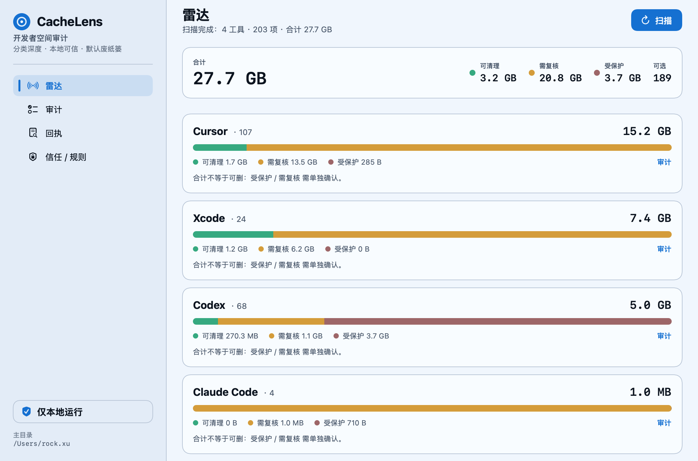
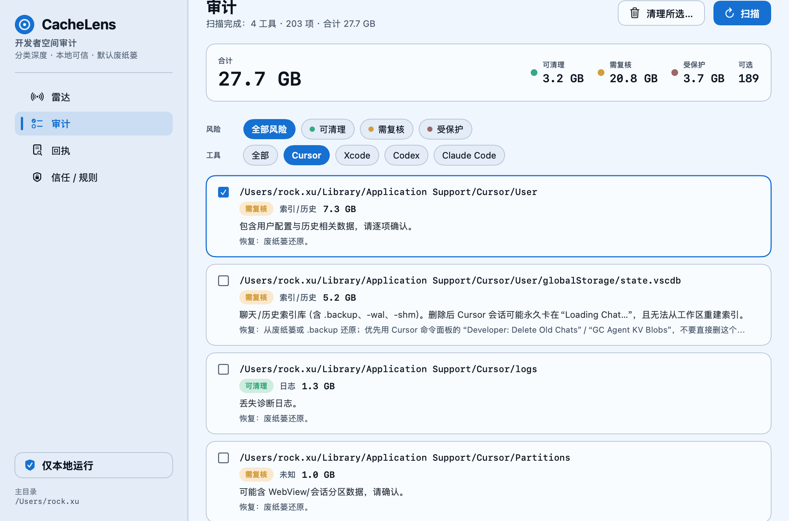

<div align="center">



# CacheLens

**专为 macOS AI 开发者打造的可解释缓存与状态审计器（SwiftUI 应用 + CLI）**

[](LICENSE)
[](#系统要求)
[](#从源码构建)
[](#零网络权限验证)

[**官网**](https://getcachelens.pages.dev/zh/) · [**下载 DMG**](https://getcachelens.pages.dev/download) · [**English**](README.md) · [**安全边界**](docs/trust/safety-boundaries.md)

</div>

---

## 为什么需要 CacheLens？

通用 Mac 清理工具把开发者目录当做普通垃圾一锅端，在 AI 编程工作流里极易引发灾难性误删：

- **Cursor `state.vscdb*`**：误删会话/索引库会导致 Cursor 永久卡在 `"Loading Chat..."`。CacheLens 将其永久判定为 **Review**（绝不判为 Safe），并提示使用编辑器内置命令清理。
- **Cursor `snapshots/*.pack`**：检查点快照几天即可膨胀至 **50–150 GB**，且在运行中删除会迅速回填。CacheLens 标出 `可能回填`，说明删除仅丢失本地检查点、代码与设置仍在，并在 Cursor 运行时拒绝清理。
- **Claude Code 与 Codex**：将对话历史与 `.credentials.json` / `auth.json` 严格分离，凭据与配置锁死在 **Protect**。
- **Ollama / LM Studio / Hugging Face**：动辄数十 GB 的 `.gguf` 模型权重标为 **Review**，绝不静默抹除。

### 与 `Mole` (`tw93/Mole`) 的关系

[`tw93/Mole`](https://github.com/tw93/Mole) 是极佳的 macOS 通用系统清理与维护工具；**CacheLens** 则是它在 **AI IDE 与 Coding Agent 场景下的特种补完**——不追求“删得最狠”，而是聚焦**分类深度、删除代价解释、规则失效即降级（Fail-Closed）与废纸篓可恢复**。

---

## 核心特性

- **三档风险边界（`Safe` / `Review` / `Protect`）**：
  - **Safe（可清理）**：已通过目录布局验证、可重建且有明确恢复路径的缓存。
  - **Review（需复核）**：体积大或重建成本高（会话库、快照、模型权重），需人工确认。
  - **Protect（受保护）**：登录凭证、API Key 与设置文件，界面不可选中。
- **失效即降级（Fail-Closed）**：每条 `Safe` 规则都绑定 `verifiedAgainst`（`verifiedAt` + `layoutMarkers`）。一旦 AI 工具升级导致目录结构漂移，CacheLens 自动将其降级为 **Review**，绝不盲目猜测。
- **默认进废纸篓 + 本地审计回执**：底层仅调用 `FileManager.trashItem`（无 `rm -rf` 路径）。每次清理都会在 `~/Library/Application Support/CacheLens/receipts/` 写入结构化 JSONL 回执。
- **进程互锁与清理前二次预检（TOCTOU）**：所属工具仍在运行、进程状态未知或扫描后磁盘状态发生变化时，直接拒绝清理。
- **内置 `cachelens` 命令行工具**：终端直接输入 `cachelens` 即可输出彩色空间雷达，支持 `--json` 与 `--dry-run`。
- **100% 本地运行、零网络权限**：源码无 `URLSession`、无埋点 SDK、不上传任何路径或文件名。

<p align="center">
  
</p>

---

## 已适配工具（16 款）

| 分类 | 工具列表 |
| :--- | :--- |
| **AI IDE 与编辑器** | Cursor、Windsurf、Trae、Antigravity、Zed |
| **终端与 Coding Agent** | Claude Code、OpenAI Codex、OpenCode、Aider |
| **IDE 扩展** | Cline、Roo Code、Continue |
| **本地模型与 Apple 开发** | Ollama、LM Studio、Hugging Face、Xcode（`DerivedData`、`Archives`、`DeviceSupport`、`CoreSimulator`） |

---

## 安装方式

### Homebrew Cask（推荐）

```bash
brew tap ggxx39/cachelens && brew install --cask cachelens
```

### 直接下载

前往 [getcachelens.pages.dev/download](https://getcachelens.pages.dev/download) 获取经过 Apple 公证的 DMG 安装包。

### 系统要求

- macOS 14.0 (Sonoma) 或更高版本

---

## CLI 快速上手

```bash
# 终端交互式输出空间雷达
cachelens

# 扫描全部已安装的 AI 开发工具（支持 JSON 输出）
cachelens scan
cachelens scan --json

# 预检演练（校验进程锁、保护清单与目录标记，不移动文件）
cachelens clean --path "/path/to/cache" --dry-run

# 将已验证项目安全移入 macOS 废纸篓
cachelens clean --path "/path/to/cache"

# 核验内置 Safe 规则与本机实际目录布局是否发生漂移
cachelens rules verify

# 以 Markdown 表格查看本地清理回执
cachelens receipts --markdown
```

---

## 零网络权限验证

可在安装后直接核验二进制权限声明（不包含任何网络客户端权限）：

```bash
codesign -d --entitlements :- /Applications/CacheLens.app
```

从源码运行完整信任与零网络门禁：

```bash
bash scripts/verify-trust.sh
bash scripts/verify-zero-network.sh
```

---

## 从源码构建

需要 macOS 14+ 与 Swift 5.9+。

```bash
git clone https://github.com/ggxx39/cachelens.git
cd cachelens

# 运行单元测试与安全自检
swift test
swift run CacheLensSelfTest

# 构建并打包 dist/CacheLens.app（包含 SwiftUI 应用、cachelens-cli 与规则资源包）
scripts/package-app.sh
open dist/CacheLens.app
```

---

## 参与贡献

欢迎通过 PR 为 `Sources/CacheLensCore/Resources/rules/catalog.json` 补充新 AI 工具规则或更新 `layoutMarkers`。请参阅 [CONTRIBUTING.md](CONTRIBUTING.md) 与 [docs/trust/safety-boundaries.md](docs/trust/safety-boundaries.md)。

## 开源协议

基于 [GNU General Public License v3.0](LICENSE) 开源。
